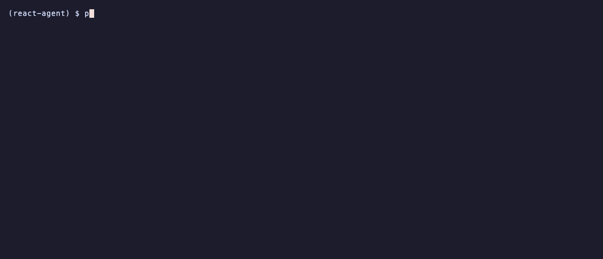

<h1 align="center">ReAct Agent</h1>

<p align="center">
  <em>A reasoning-and-acting agent built from scratch: tool use, a transparent control loop, and full step tracing.</em>
</p>

<p align="center">
  <a href="https://github.com/adeoluo/react-agent/actions/workflows/ci.yml"></a>
  <a href="https://github.com/adeoluo/react-agent/releases"></a>
  
  <a href="LICENSE"></a>
</p>

---

## Motivation

Agent frameworks hide the one thing worth understanding: the control loop that turns a
language model into something that *acts*. This project implements the ReAct pattern
(interleaved **Rea**soning and **Act**ing) from scratch, so the mechanism is fully visible:
how a prompt is built, how the model's output is parsed into an action, how a tool is
executed, and how the observation feeds the next step.

Two properties make it suitable for real use: every run is a **fully auditable trace**, and
the loop **recovers** from malformed output, unknown tools, and tool failures by turning each
into feedback the model can act on, instead of crashing.

## Architecture

<p align="center">
  
</p>

<sub>Legend: amber = entry points and external systems, indigo = core logic, green = data and state, blue = validation and control, grey = observability and outputs.</sub>

The **Agent** builds a **prompt** from the question, the tool descriptions, and the running
scratchpad; the **language model** returns a Thought plus an Action; the **parser** turns
that text into a structured decision; the chosen **tool** runs and its observation is
appended; the loop repeats until a Final Answer or a step limit. Tools, the model, and the
registry are all injected, so a deterministic scripted model and a frontier API are
interchangeable. See the [architecture decision records](docs/adr/) for key choices.

### Capabilities

A complete, from-scratch agent toolkit that runs fully offline:

- **10 built-in tools** across arithmetic, retrieval, dates, units, and text, plus a
  structured knowledge base, all safe (the calculator uses an AST allow-list, never
  `eval`) and all raising recoverable `ToolError`s on bad input.
- **Robust control loop** that recovers from malformed output, unknown tools, declared
  *and undeclared* tool exceptions (timeouts, bugs), non-string or oversized tool output,
  and injection-style tool text, by turning each into an observation, and always
  terminates within `max_steps`.
- **Retry and recovery**: a tool can raise `RetryableToolError` to have the agent retry it
  (`tool_retries`) before the failure is surfaced as an observation to re-plan against.
- **Observability** via `Callbacks` hooks (step, action, observation, tool-retry, finish)
  and a ready-made logging-callbacks factory; a `--verbose` CLI flag streams each step.
- **Budgets**: `max_steps`, an optional `max_prompt_chars` cap (a token-cost proxy), and a
  `max_observation_chars` cap that bounds untrusted tool output.
- **Benchmarking**: a `BenchmarkTask` + `run_benchmark` harness with an eight-task suite
  (including multi-step questions) and a deterministic rule-policy model, producing a real,
  reproducible **success rate** and a single-shot baseline comparison.
- **Trace export**: lossless JSON serialization of a full run (`--json PATH`), the
  substrate for trace viewers and offline analysis.

### Robustness

The control loop is tested against each failure mode it is designed to survive, including
hostile and buggy tools, and in every case it turns the failure into an observation and
still terminates within `max_steps`:

| Failure | How the loop recovers |
|---|---|
| Malformed model output | A `ParseError` becomes a formatting reminder observation |
| Unknown tool requested | The observation lists the valid tool names |
| A tool raises `ToolError` | The error message becomes the observation |
| A tool raises an *undeclared* exception (bug, timeout) | Contained and turned into an observation; never propagated |
| A tool returns non-string or oversized output | Coerced to a string and truncated to `max_observation_chars` |
| Injection-style tool output (`Final Answer:` in the text) | Recorded as inert data; only the model's own completions can finish the run |
| A transient tool failure (`RetryableToolError`) | Retried up to `tool_retries` times, then surfaced as an observation to re-plan |
| No answer within budget / a looping model | The run stops at `max_steps` and reports `finished = False` |

These are enforced by `tests/test_adversarial.py`, which drives each case with a scripted
model so the guarantees are deterministic and offline.

## Results

### Benchmark

The offline agent, driven by the deterministic rule-policy model over the full toolset,
solves the built-in suite end to end (`python -m react_agent benchmark`):

```text
Benchmark: 8/8 passed (100.0%), mean 1.2 steps
  [PASS] arithmetic-basic (1 steps)
  [PASS] capital-france (1 steps)
  [PASS] multi-capital-and-arithmetic (2 steps)
  ...

Loop vs. single-shot baseline:
  ReAct loop     : 8/8 passed (100.0%), mean 1.2 steps
  single-shot    : 0/8 passed (0.0%), mean 1.0 steps
  loop lift      : +100.0 percentage points
```

The suite includes multi-step questions (for example "the capital of France, *and* 21 times
2") that need more than one tool call. To show the loop is doing the work, the harness also
runs a **single-shot baseline**: the same model and tools with a one-step budget (one model
turn, no observe-then-replan). It solves **0/8**, because every task needs a tool
observation fed back into reasoning, while the full loop solves **8/8**: a **+100 percentage
point** lift that is the ReAct loop itself.

| Agent | Tasks passed | Success rate | Mean steps |
|---|---:|---:|---:|
| ReAct loop (`max_steps=6`) | 8 / 8 | 100.0% | 1.2 |
| single-shot baseline (`max_steps=1`) | 0 / 8 | 0.0% | 1.0 |

These numbers come from the deterministic offline rule-policy model; in production a frontier
model replaces it behind the same interface.

### Performance

> Measured with `uv run python benchmarks/benchmark.py`.

| Operation | Throughput |
|---|---:|
| Full agent runs (plan, act, observe, answer) over the eight-task suite | ~20,000-27,000 runs / sec |
| Calculator tool calls (AST evaluation) | ~150,000 calls / sec |

The control loop and tools run in-process and offline, so the agent's own overhead is
negligible next to the model calls a production deployment would make. The suite now
includes two-tool-call questions, so each run averages more than one step; the numbers are
environment-specific and reproduced per machine.

### Scale

`benchmarks/scale.py` runs the rule-policy agent over progressively larger synthetic
batches of arithmetic tasks, reporting wall-clock time, run throughput, peak memory
(stdlib `tracemalloc`, measured in a separate pass so its per-allocation hook does not
distort timing), and the task success rate. Measured on this machine (`uv run python
benchmarks/scale.py`):

| Agent runs | Seconds | Runs/sec | Peak MiB | Success |
|---:|---:|---:|---:|---:|
| 1,000 | 0.20 | ~5,100 | 0.2 | 1.00 |
| 2,000 | 0.41 | ~4,900 | 0.3 | 1.00 |
| 4,000 | 0.53 | ~7,500 | 0.5 | 1.00 |
| 8,000 | 1.37 | ~5,900 | 1.0 | 1.00 |

The shape is the point: the ReAct loop is O(1) work per task, so throughput stays
roughly flat as the batch grows while peak memory rises linearly with the retained
per-task traces and answers; success stays at 100%. These numbers are from synthetic
tasks on an in-process Python loop with an offline deterministic model: they measure harness
overhead, **not** a frontier model's latency, and are **not** a comparison against a
hosted agent framework.

## Quickstart

```bash
git clone https://github.com/adeoluo/react-agent.git && cd react-agent
make setup                    # install dev tooling + pre-commit hooks
make all                      # lint + type-check + test

python -m react_agent tools        # list the built-in tools
python -m react_agent demonstrate  # run the offline scripted example
python -m react_agent benchmark    # run the offline benchmark suite
```

## Usage

A real run of the offline ReAct loop: thoughts, tool calls, observations, and the final answer. Regenerate with `vhs docs/demo/demonstrate.tape`.

<p align="center">
  
</p>

### Demonstration

Fully offline, via `python -m react_agent demonstrate`:

```text
Question: What is the capital of France, and what is 21 times 2?
Thought: I should look up the capital of France.
Action: search
Action Input: capital of France
Observation: Paris is the capital and most populous city of France.
Thought: Now I compute 21 times 2.
Action: calculator
Action Input: 21 * 2
Observation: 42
Final Answer: The capital of France is Paris, and 21 times 2 is 42.
```

### Using a frontier model

Install the provider's optional extra and set an API key:

```bash
uv sync --extra openai        # or: --extra anthropic
export OPENAI_API_KEY=...
python -m react_agent run --verbose --json trace.json \
    "What is 17 * 23, and what is the capital of Japan?"
```

### Built-in tools

- **calculator**: arithmetic through an AST operator allow-list; never uses `eval`.
- **search**: fuzzy, offline lookup over a bundled knowledge base.
- **knowledge_base**: structured attribute lookup (`capital of France`).
- **memory**: a per-run key-value scratchpad (`set k = v` / `get k`).
- **date_difference** / **weekday**: deterministic date reasoning.
- **convert_units**: length, mass, and temperature conversion.
- **text_length** / **text_transform** / **count_occurrences**: string utilities.

`default_toolset()` provides the core three; `full_toolset()` provides all ten.

### HTTP service

A standard-library HTTP service runs the agent with the offline, deterministic rule-policy
model and the full toolset:

```bash
python -m react_agent serve --port 8000

curl localhost:8000/health
curl -s -X POST localhost:8000/run -d '{"question": "What is 2 * (3 + 4)?"}'
```

`GET /health` lists the tools and model; `POST /run` returns the answer, whether the agent
finished, and the full typed trace. The service also exposes `GET /ready` (readiness) and
`GET /metrics` (per-route request, error, and latency metrics in Prometheus text format). A
production-style stress benchmark (`uv run python benchmarks/stress.py`) reports throughput
and p50/p95/p99 latency; with the offline model a single core serves tens of thousands of
bounded runs per second. The step budget bounds every request, which with a provider model
bounds the number of model calls and therefore spend. See the
[operations guide](docs/OPERATIONS.md), the [scaling and tradeoffs](docs/SCALING.md)
document, and the [case study](docs/CASE_STUDY.md).

### Demos

Recorded from real runs with [vhs](https://github.com/charmbracelet/vhs); each tape is in `docs/demo/`.

The offline benchmark suite, then the tool list.

<p align="center">
  
</p>

## Design decisions

- **Structural `Protocol` typing** for `Tool` and `LanguageModel`: any object with the
  right shape is a first-class citizen, so stubs and APIs are interchangeable.
  ([ADR-0002](docs/adr/0002-protocol-interfaces.md))
- **Recover, do not crash.** Every failure becomes an observation, which both matches how
  capable agents behave and keeps runs debuggable.
  ([ADR-0003](docs/adr/0003-error-recovery-as-observation.md))
- **Optional provider SDKs.** The agent core runs offline on its own; provider SDKs are
  optional and lazily imported.
- **Recording decisions.** ([ADR-0001](docs/adr/0001-record-architecture-decisions.md))

## Testing

```bash
make test                     # uv run pytest
make coverage                 # pytest with an 80% coverage gate
```

The suite has 120 deterministic, offline tests in thirteen modules under `tests/`; model
behavior is driven by a scripted model or the rule-policy model, so no network or API key is
needed:

- **Control loop** (`test_agent.py`, `test_parser.py`, `test_prompt.py`): the ReAct loop
  including failure recovery, parsing of model output, and prompt construction.
- **Adversarial tool use** (`test_adversarial.py`): every row of the robustness table above,
  including undeclared exceptions, timeouts, non-string and oversized output, injection-style
  text, and retryable failures.
- **Tools** (`test_tool.py`, `test_tools.py`, `test_extended_tools.py`): the tool abstraction
  and registry, the built-in tools, and the extended tool library.
- **Benchmark** (`test_benchmark.py`): the harness, the suite, and the rule-policy model.
- **Observability and budgets** (`test_callbacks.py`, `test_trace.py`): callbacks, the
  prompt-size budget, trace export, and logging callbacks.
- **Adapters and interfaces** (`test_llms.py`, `test_cli.py`, `test_service.py`): the scripted
  model and provider adapters, the CLI, and the HTTP request handler.

CI (`.github/workflows/ci.yml`) runs `ruff format --check`, `ruff check`, `mypy src`, and
`pytest` with an 80% coverage gate on Python 3.11 and 3.12, then builds the package and the
Docker image.

## Responsible AI

- **Model card:** [docs/MODEL_CARD.md](docs/MODEL_CARD.md)
- **Data card:** [docs/DATA_CARD.md](docs/DATA_CARD.md)
- **Threat model:** [docs/THREAT_MODEL.md](docs/THREAT_MODEL.md)

## Limitations

- The bundled search tool is a small fixed knowledge base, not real retrieval.
- Single-agent and single-tool-per-step by design; planning, multiple agents, and
  parallel tool calls are out of scope (and are the subject of later portfolio projects).
- Provider-backed runs are only as reliable as the underlying model's adherence to the
  ReAct format; the parser is lenient but not magic.

## Roadmap

- [ ] Streaming token output for provider models
- [ ] Reflection step (self-critique) before the final answer
- [x] A benchmark harness scoring task success over a suite of questions
- [x] Adversarial-robustness tests and tool retry/recovery

## License

Released under the [MIT License](LICENSE).
