<h1 align="center">ReAct Agent</h1>

<p align="center">
  <em>A reasoning-and-acting agent built from scratch: tool use, a transparent control loop, and full step tracing.</em>
</p>

<p align="center">
  <a href="https://github.com/adeoluo/react-agent/actions/workflows/ci.yml"></a>
  
  
  
  
  
</p>

---

## Motivation

Agent frameworks hide the one thing worth understanding: the control loop that turns a
language model into something that *acts*. This project implements the ReAct pattern
(interleaved **Rea**soning and **Act**ing) from first principles, with **zero runtime
dependencies**, so the mechanism is fully visible - how a prompt is built, how the model's
output is parsed into an action, how a tool is executed, and how the observation feeds the
next step.

Two properties make it principle-level rather than a toy: every run is a **fully auditable
trace**, and the loop **recovers** from malformed output, unknown tools, and tool failures
by turning each into feedback the model can act on, instead of crashing.

## Architecture

<p align="center">
  
</p>

The **Agent** builds a **prompt** from the question, the tool descriptions, and the running
scratchpad; the **language model** returns a Thought plus an Action; the **parser** turns
that text into a structured decision; the chosen **tool** runs and its observation is
appended; the loop repeats until a Final Answer or a step limit. Tools, the model, and the
registry are all injected, so a deterministic scripted model and a frontier API are
interchangeable. See the [architecture decision records](docs/adr/) for key choices.

## Demonstration

## Capabilities

A complete, from-scratch agent toolkit, all offline and dependency-free:

- **10 built-in tools** across arithmetic, retrieval, dates, units, and text, plus a
  structured knowledge base - all safe (the calculator uses an AST allow-list, never
  `eval`) and all raising recoverable `ToolError`s on bad input.
- **Robust control loop** that recovers from malformed output, unknown tools, and tool
  failures by turning each into an observation.
- **Observability** via `Callbacks` hooks (step, action, observation, finish) and a
  ready-made logging-callbacks factory; a `--verbose` CLI flag streams each step.
- **Budgets**: `max_steps` and an optional `max_prompt_chars` cap (a token-cost proxy).
- **Benchmarking**: a `BenchmarkTask` + `run_benchmark` harness with a six-task suite and
  a deterministic rule-policy model, producing a real, reproducible **success rate**.
- **Trace export**: lossless JSON serialization of a full run (`--json PATH`), the
  substrate for trace viewers and offline analysis.

## Benchmark

The offline agent, driven by the deterministic rule-policy model over the full toolset,
solves the built-in suite end to end (`python -m react_agent benchmark`):

```text
Benchmark: 6/6 passed (100.0%), mean 1.0 steps
  [PASS] arithmetic-basic (1 steps)
  [PASS] capital-france (1 steps)
  [PASS] convert-temperature (1 steps)
  ...
```

### Performance

> Measured with `uv run python benchmarks/benchmark.py`.

| Operation | Throughput |
|---|---:|
| Full agent runs (plan, act, observe, answer) | ~46,000 runs / sec |
| Calculator tool calls (AST evaluation) | ~190,000 calls / sec |

The control loop and tools are pure-Python and offline, so the agent's own overhead is
negligible next to the model calls a production deployment would make.

## Demonstration

Fully offline, via `python -m react_agent demonstrate`:

```text
Question: What is the capital of France, and what is 21 times 2?
Thought: I should look up the capital of France.
Action: search
Action Input: capital of France
Observation: Paris is the capital and most populous city of France.
Thought: Now I compute 21 times 2.
Action: calculator
Action Input: 21 * 2
Observation: 42
Final Answer: The capital of France is Paris, and 21 times 2 is 42.
```

## Robustness

The control loop is tested against each failure mode it is designed to survive:

| Failure | How the loop recovers |
|---|---|
| Malformed model output | A `ParseError` becomes a formatting reminder observation |
| Unknown tool requested | The observation lists the valid tool names |
| A tool raises `ToolError` | The error message becomes the observation |
| No answer within budget | The run stops at `max_steps` and reports `finished = False` |

## Quickstart

```bash
git clone https://github.com/adeoluo/react-agent.git && cd react-agent
make setup                    # install dev tooling + pre-commit hooks
make all                      # lint + type-check + test

python -m react_agent tools        # list the built-in tools
python -m react_agent demonstrate  # run the offline scripted example
python -m react_agent benchmark    # run the offline benchmark suite
```

Use a frontier model by installing its optional extra and setting an API key:

```bash
uv sync --extra openai        # or: --extra anthropic
export OPENAI_API_KEY=...
python -m react_agent run --verbose --json trace.json \
    "What is 17 * 23, and what is the capital of Japan?"
```

## Built-in tools

- **calculator** - arithmetic through an AST operator allow-list; never uses `eval`.
- **search** - fuzzy, offline lookup over a bundled knowledge base.
- **knowledge_base** - structured attribute lookup (`capital of France`).
- **memory** - a per-run key-value scratchpad (`set k = v` / `get k`).
- **date_difference** / **weekday** - deterministic date reasoning.
- **convert_units** - length, mass, and temperature conversion.
- **text_length** / **text_transform** / **count_occurrences** - string utilities.

`default_toolset()` provides the core three; `full_toolset()` provides all ten.

## Design decisions

- **Structural `Protocol` typing** for `Tool` and `LanguageModel`: any object with the
  right shape is a first-class citizen, so stubs and APIs are interchangeable.
  ([ADR-0002](docs/adr/0002-protocol-interfaces.md))
- **Recover, do not crash.** Every failure becomes an observation, which both matches how
  capable agents behave and keeps runs debuggable.
  ([ADR-0003](docs/adr/0003-error-recovery-as-observation.md))
- **Zero runtime dependencies.** The agent is pure Python; provider SDKs are optional and
  lazily imported.

## Running the service

A dependency-free HTTP service runs the agent with the offline, deterministic rule-policy
model and the full toolset:

```bash
python -m react_agent serve --port 8000

curl localhost:8000/health
curl -s -X POST localhost:8000/run -d '{"question": "What is 2 * (3 + 4)?"}'
```

`GET /health` lists the tools and model; `POST /run` returns the answer, whether the agent
finished, and the full typed trace. A production-style stress benchmark
(`uv run python benchmarks/stress.py`) reports throughput and p50/p95/p99 latency; with the
offline model a single core serves tens of thousands of bounded runs per second. The step
budget bounds every request, which with a provider model bounds the number of model calls
and therefore spend. See the [operations guide](docs/OPERATIONS.md), the
The service also exposes `GET /ready` (readiness) and `GET /metrics` (per-route request, error, and latency metrics in Prometheus text format).
[scaling and tradeoffs](docs/SCALING.md) document, and the [case study](docs/CASE_STUDY.md).

## Responsible AI

- **Model card:** [docs/MODEL_CARD.md](docs/MODEL_CARD.md)
- **Data card:** [docs/DATA_CARD.md](docs/DATA_CARD.md)
- **Threat model:** [docs/THREAT_MODEL.md](docs/THREAT_MODEL.md)

## Limitations

- The bundled search tool is a small fixed knowledge base, not real retrieval.
- Single-agent and single-tool-per-step by design; planning, multiple agents, and
  parallel tool calls are out of scope (and are the subject of later portfolio projects).
- Provider-backed runs are only as reliable as the underlying model's adherence to the
  ReAct format; the parser is lenient but not magic.

## Roadmap

- [ ] Streaming token output for provider models
- [ ] Reflection step (self-critique) before the final answer
- [ ] A benchmark harness scoring task success over a suite of questions

## License

[MIT](LICENSE). Part of an artificial intelligence engineering portfolio by
[adeoluo](https://github.com/adeoluo).
